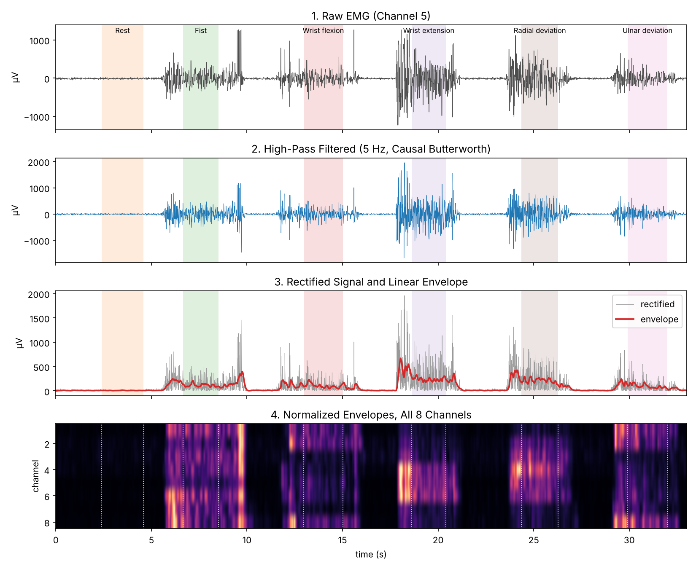
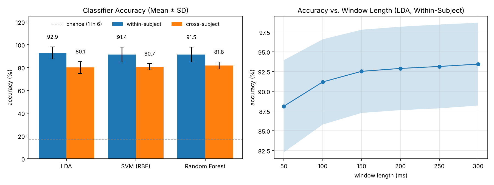
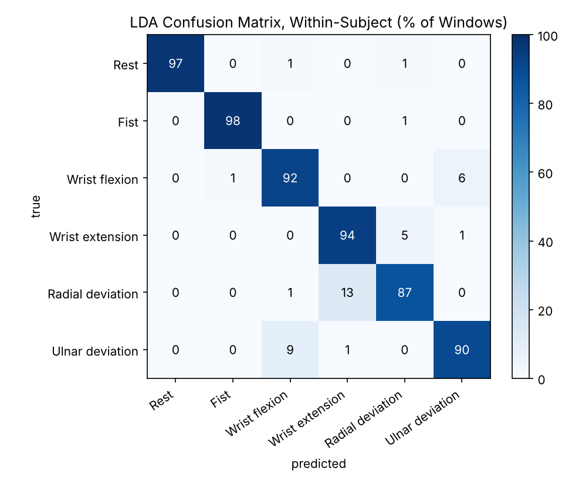
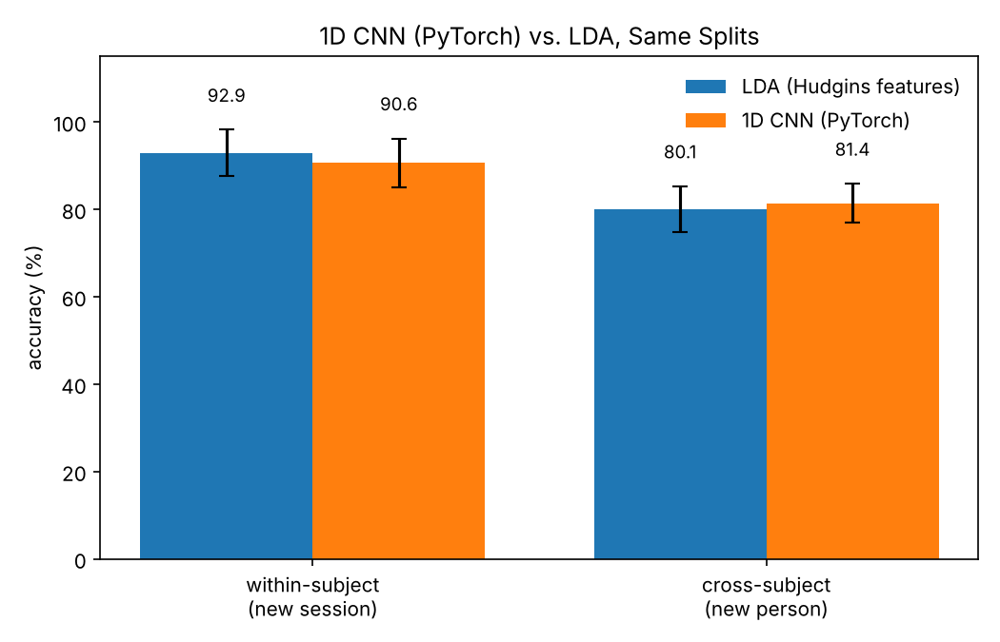

# EMG Gesture Classifier


Classifies 6 hand and wrist gestures from 8-channel forearm surface EMG using Hudgins time-domain features with LDA, SVM, and random forest classifiers, and compares them with a PyTorch 1D CNN that learns features directly from the filtered signal. All filtering is causal, so the pipeline uses only data a real-time controller would have.



## Results

36 subjects, 2 sessions each, 200 ms windows with a 50 ms step.

| Classifier | Within-Subject (%) | Cross-Subject (%) |
|---|---|---|
| LDA | 92.9 ± 5.3 | 80.1 ± 5.2 |
| SVM (RBF) | 91.4 ± 6.6 | 80.7 ± 2.7 |
| Random Forest | 91.5 ± 6.4 | 81.8 ± 3.2 |

- **Within-subject** (train on session 1, test on session 2): LDA scores highest and is the cheapest at inference (one matrix multiply per window), which is why it is the standard baseline in myoelectric control.
- **Cross-subject** (6 fixed subject folds; no subject appears in both train and test): accuracy drops 10 to 13 points due to differences in anatomy, electrode placement, and skin impedance. Clinical systems calibrate per user for this reason.
- **Window length** sets the minimum decision delay. LDA accuracy rises from 88.1% at 50 ms to 93.4% at 300 ms. About 300 ms of total controller delay is the commonly cited usability limit (Englehart and Hudgins, 2003).



Largest confusions: radial deviation predicted as wrist extension (13%) and ulnar deviation predicted as wrist flexion (9%). Each pair shares prime movers: extensor carpi radialis longus and brevis drive both radial deviation and extension; flexor carpi ulnaris drives both ulnar deviation and flexion.



## Deep Learning Comparison (PyTorch)

A small 1D CNN (`emg/deep.py`: three conv blocks, global average pooling, 25,190 parameters) takes the high-pass filtered window itself (8 channels x 40 samples) instead of hand-designed features. It is evaluated on exactly the same windows and splits as LDA.

| Model | Input | Within-Subject (%) | Cross-Subject (%) |
|---|---|---|---|
| LDA | 40 Hudgins features | 92.9 ± 5.3 | 80.1 ± 5.2 |
| 1D CNN (PyTorch) | filtered window, 8 x 40 | 90.6 ± 5.6 | 81.4 ± 4.5 |

- **Cross-subject**, where training data is large (about 23,000 windows from 30 people), the CNN beats LDA by 1.3 points with lower variance across folds.
- **Within-subject**, with only about 380 training windows per person, LDA still wins by 2.3 points. Hand-designed features are a strong prior when data is scarce, which is why LDA remains the clinical baseline.
- Inference takes 0.39 ms per window on one CPU thread, well inside the 50 ms window step.



Run with `python run_deep.py` (or launcher option 3). PyTorch is optional and listed in `requirements-deep.txt`.

## Method

1. **Resample** each recording onto a uniform 200 Hz grid (raw timestamps are irregular). EMG is linearly interpolated; labels use zero-order hold.
2. **High-pass filter** at 5 Hz (4th-order Butterworth, causal `sosfilt`) to remove DC offset and motion artifact.
3. **Window** into 200 ms segments every 50 ms. Windows spanning a gesture transition or unlabeled data are discarded.
4. **Extract features** per channel: log mean absolute value, log RMS, log waveform length, zero crossings, slope sign changes. 5 features x 8 channels = 40 per window, computed for all windows in one vectorized call.
5. **Classify** with LDA, RBF SVM, and random forest (scikit-learn), with standardization for LDA and SVM.

## Evaluation Design

Overlapping windows from one recording are highly correlated. A random window-level split puts near-duplicates in both train and test and inflates accuracy, so this project splits only by session or by subject.

## Limitations

The Myo stream in this dataset updates at about 100 Hz (roughly 90% of rows in the raw files repeat the previous sample). Surface EMG extends to about 450 Hz, so only low-frequency content is captured. Absolute accuracy is not comparable to clinical systems sampling at 1 to 2 kHz; comparisons between models and evaluation schemes remain valid.

## Getting Started (Mac or Windows, No Experience Needed)

You do not need to know Python. Each step says exactly what to click or type; copying and pasting is fine.

**1. Install Python (once per computer)**

- **Mac:** open Terminal (press Cmd+Space, type `Terminal`, press Return). Type `python3 --version` and press Return.
  - If it shows Python 3.9 or newer, go to step 2.
  - If a box offers to install the "command line developer tools", click **Install**, wait for it to finish, and check again.
  - Otherwise download the macOS installer from https://www.python.org/downloads/, open it, and click through.
- **Windows:** download the installer from https://www.python.org/downloads/ and open it. On the first screen tick **Add python.exe to PATH**, then click **Install Now**.

**2. Download this project**

Click the green **Code** button at the top of this page, then **Download ZIP**. Unzip it: on a Mac double-click the ZIP in Downloads; on Windows right-click it, choose **Extract All**, then **Extract**. You now have a folder named `EMG-Gesture-Classifier-main`.

**3. Start it**

- **Windows:** open the `EMG-Gesture-Classifier-main` folder and double-click **start.bat**.
- **Mac:** in Terminal type `cd ` (with a space after it), drag the `EMG-Gesture-Classifier-main` folder from Finder into the Terminal window, and press Return. Then type `python3 start.py` and press Return.

The first time, it sets itself up: it creates a private Python environment inside the project folder and downloads the libraries it needs. This takes a few minutes and needs internet. Then a menu appears. Type a number and press Enter:

| Option | What it does | What you get |
| --- | --- | --- |
| 1 | Run the full analysis | Downloads the public EMG dataset (17 MB) the first time, trains and tests the classifiers (about 4 minutes), saves the figures in `figures/` and the numbers in `results.md`, then opens the summary chart |
| 2 | Run the automated tests | Checks the signal processing and feature code (no dataset needed) |

To use it again later, repeat step 3; setup is skipped and the menu appears in a few seconds. Type `q` and press Enter to quit.

**Troubleshooting**

| Problem | Fix |
| --- | --- |
| Mac: `command not found: python3` | Install Python (step 1). |
| Windows: `Python was not found`, or the Microsoft Store opens | Install Python from python.org (step 1) and tick **Add python.exe to PATH**. If you already installed it without that box, run the installer again, choose **Modify**, then **Next**, and tick **Add Python to environment variables**. |
| Windows: "Windows protected your PC" when opening start.bat | Click **More info**, then **Run anyway**. The file only runs `py start.py`; you can open it in Notepad to check. |
| `This project needs Python 3.9 or newer` | Install the current Python from https://www.python.org/downloads/ |
| `CERTIFICATE_VERIFY_FAILED` while downloading the dataset (Mac) | The project uses the `certifi` certificates to avoid this. If it still happens, open Finder, go to Applications, open your Python folder and double-click **Install Certificates.command**, then try again. |
| The analysis seems stuck | It takes about 4 minutes, longer on older laptops. Wait for `Done.` |
| `Installing libraries failed` or setup stops with an error | Check your internet connection, delete the `.venv` folder inside the project folder, and start again. (On a Mac the folder is hidden: press Cmd+Shift+. in Finder to show it.) |
| A figure did not open by itself | Look in the project's `figures` folder. |

**For developers.** `start.py` only creates `.venv`, installs `requirements.txt` and runs the commands below, so you can also work by hand (Python 3.9 or newer):

```bash
# macOS / Linux
python3 -m venv .venv
source .venv/bin/activate
pip install -r requirements.txt
```

```powershell
# Windows (PowerShell or Command Prompt)
py -m venv .venv
.venv\Scripts\activate       # if PowerShell blocks this: Set-ExecutionPolicy -Scope CurrentUser RemoteSigned
pip install -r requirements.txt
```

```bash
python run_pipeline.py      # full analysis
python -m pytest            # tests
```

`python start.py <shortcut>` runs one menu option directly (`python start.py --list` shows the shortcuts). CI runs the tests through `start.py` on macOS, Windows and Linux with Python 3.9 and 3.13.

### Command Line

`run_pipeline.py` writes `figures/` and `results.md` (including the full window-length sweep).

## Project Structure

```
start.py                    Beginner launcher: sets up .venv, shows the menu (start.bat on Windows)
emg/
  data.py          download, load, resample to a uniform grid
  preprocess.py    causal filters, linear envelope, windowing
  features.py      Hudgins time-domain features (vectorized)
  deep.py          PyTorch 1D CNN with a scikit-learn style wrapper
run_pipeline.py    evaluation, figures, results.md
run_deep.py        CNN vs. LDA on the same splits, results_deep.md
tests/
```

## Tests

- Features match closed-form values for a pure sine: MAV = 2A/π, RMS = A/√2, waveform length = 4A per cycle, 2 zero crossings and 2 slope sign changes per cycle
- Thresholds reject low-amplitude noise; flat windows produce finite features
- High-pass filter removes DC and passes a 40 Hz tone; envelope tracks a burst
- Windowing never mixes labels; resampling interpolates EMG and holds labels
- CNN (when PyTorch is installed): output shape, parameter budget, learns separable toy gestures, deterministic with a seed, normalization uses training statistics only

## Data and License

Krilova, N., Kastalskiy, I., Kazantsev, V., Makarov, V., and Lobov, S. (2018). *EMG Data for Gestures* [Dataset]. UCI Machine Learning Repository. https://doi.org/10.24432/C5ZP5C. CC BY 4.0.

Code: MIT License.
